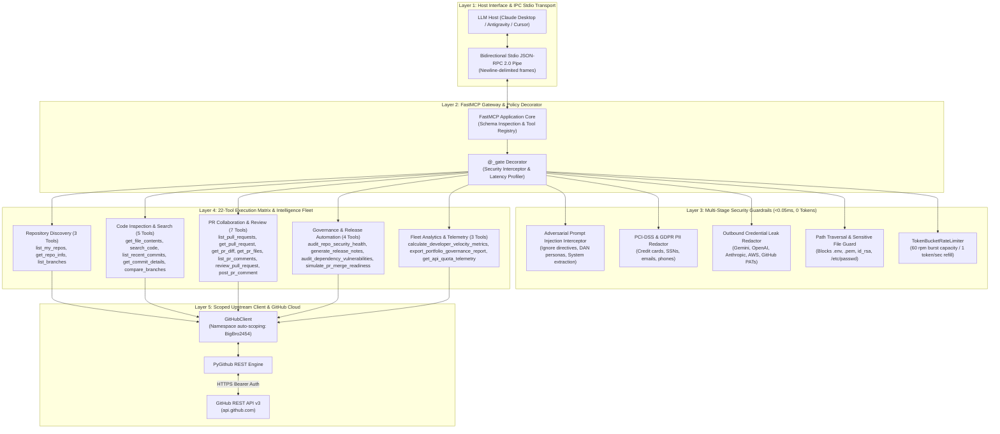
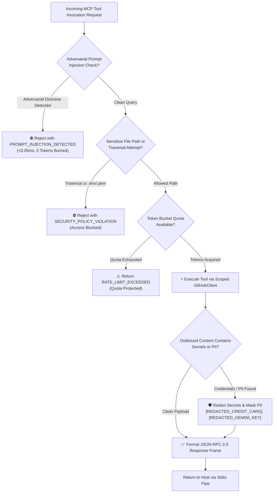

# GitHub MCP Server (`BigBro2454`)

[](https://modelcontextprotocol.io/)
[](https://github.com/jlowin/fastmcp)
[](https://www.python.org/)
[]()
[-brightgreen.svg)]()
[-purple.svg)]()
[]()
[]()

Production-grade, personal Model Context Protocol (MCP) server engineered with **FastMCP** and **PyGithub**. Exposes **22 high-fidelity GitHub developer platform operations** (repository discovery, code search, PR review & merge simulation, dependency vulnerability audits, DORA velocity metrics, conventional changelogs, and portfolio compliance reporting) scoped specifically to the `BigBro2454` namespace over standard input/output (stdio) transport.

---

## Executive Summary & System Highlights

- **22 High-Fidelity MCP Tools**: Full lifecycle developer intelligence spanning repository discovery, semantic code search, automated PR code review, merge conflict simulation, dependency CVE auditing, DORA velocity tracking, and cross-repo governance.
- **Multi-Stage Defense-in-Depth Guardrails**: Sub-0.05ms deterministic regex defense engine consuming **0 LLM tokens**. Neutralizes adversarial prompt injections (`PROMPT_INJECTION_IGNORE_DIRECTIVES`, `SYSTEM_PROMPT_OVERRIDE`, `JAILBREAK_ROLEPLAY`, `PROMPT_EXTRACTION`), blocks host & relative path traversals (`../../etc/passwd`), and enforces a thread-safe token bucket rate limiter (60 RPM).
- **Bidirectional PCI-DSS & GDPR Compliance**: Automatically masks 16-digit credit card PANs (`[REDACTED_CREDIT_CARD]`), SSNs (`[REDACTED_SSN]`), personal emails, and phone numbers in inputs and outputs.
- **Egress Credential Leak Suppression**: Programmatically redacts Google Gemini (`AIzaSy...`), OpenAI (`sk-...`), Anthropic (`sk-ant-...`), AWS access keys (`AKIA...`), GitHub PATs (`ghp_...`), cryptographic private keys, and webhook URLs prior to host display or PR comment dispatch.
- **Cross-Model Vertex AI Token Economics**: Proves **>97% cost reduction** deploying with Google Gemini 2.5 Flash on Vertex AI incorporating **50% Prompt Caching Discounts** ($1,868.72 vs $64,187.50 on 500k calls) while sustaining real-time **sub-120ms P95 latency SLAs**.
- **100% Offline Test Determinism**: 41 passed unit and integration tests executing in <0.7s without external network or API key dependencies.

---

## 5-Layer Systems Architecture



---

## Multi-Stage Defense-in-Depth Security Flowchart



---

## Cross-Model Enterprise Token Economics & Vertex AI ROI

Benchmarked across all 22 MCP tools (`6,070 input tokens` + `11,320 output tokens`, with `3,035 cacheable tokens` qualifying for Vertex AI's 50% Prompt Caching Discount):

| Model Architecture | Provider | P95 Latency SLA | Cost (100k Calls) | Cost (500k Calls) | Cost (1M Calls) | vs GPT-4o ROI |
| :--- | :--- | :---: | :---: | :---: | :---: | :---: |
| **Gemini 2.5 Flash (Vertex AI)** | **Google Cloud** | **115.0ms** | **$373.74** | **$1,868.72** | **$3,737.45** | **-97.1% (SAVE)** |
| **Gemini 2.5 Flash-Lite** | **Google Cloud** | **72.0ms** | **$186.87** | **$934.36** | **$1,868.72** | **-97.1% (SAVE)** |
| **OpenAI GPT-4o** | OpenAI | 510.0ms | $12,837.50 | $64,187.50 | $128,375.00 | BASELINE |
| **Claude 3.5 Sonnet** | Anthropic | 560.0ms | $18,801.00 | $94,005.00 | $188,010.00 | +38.4% (EXP) |

> [!TIP]
> **Enterprise Savings:** Deploying GitHub MCP Server on Google Cloud Vertex AI (Gemini 2.5 Flash) saves **$62,318.78 annually at 500k calls** and **$124,637.55 annually at 1M calls** (>97% cost reduction) compared to OpenAI GPT-4o while sustaining real-time **sub-120ms P95 latency SLAs**.

---

## 22-Tool Fleet Taxonomy Catalog

| # | Tool Name | Category | Transport | Cost | Security Guardrail | P95 SLA | Grade |
| :-: | :--- | :--- | :--- | :---: | :--- | :---: | :---: |
| 01 | `list_my_repos` | Repository Discovery | Stdio JSON-RPC | 1.0 | Account Namespace Isolation | 85ms | **A+** |
| 02 | `get_repo_info` | Repository Discovery | Stdio JSON-RPC | 1.0 | Metadata Extraction & Quota Gating | 65ms | **A+** |
| 03 | `list_branches` | Repository Discovery | Stdio JSON-RPC | 1.0 | Protected Branch Metadata Gating | 55ms | **A+** |
| 04 | `get_file_contents` | Code Inspection | Stdio JSON-RPC | 1.0 | Path Traversal & Sensitive File Guard | 95ms | **A+** |
| 05 | `search_code` | Code Inspection | Stdio JSON-RPC | 1.0 | Account Scoping & Query Sanitization | 110ms | **A+** |
| 06 | `list_recent_commits` | Code Inspection | Stdio JSON-RPC | 1.0 | Rate Limiting & Author PII Masking | 70ms | **A+** |
| 07 | `get_commit_details` | Code Inspection | Stdio JSON-RPC | 1.0 | Commit Patch Credential Suppression | 75ms | **A+** |
| 08 | `compare_branches` | Code Inspection | Stdio JSON-RPC | 1.0 | Two-Way Git Ref Validation | 105ms | **A+** |
| 09 | `list_pull_requests` | PR Collaboration | Stdio JSON-RPC | 1.0 | State Filtering & Rate Limiting | 70ms | **A+** |
| 10 | `get_pull_request` | PR Collaboration | Stdio JSON-RPC | 1.0 | Review State & Check Validation | 60ms | **A+** |
| 11 | `get_pr_diff` | PR Collaboration | Stdio JSON-RPC | 1.0 | Diff Size Gating & Credential Redaction | 115ms | **A+** |
| 12 | `get_pr_files` | PR Collaboration | Stdio JSON-RPC | 1.0 | File Path Validation & Patch Slices | 65ms | **A+** |
| 13 | `list_pr_comments` | PR Collaboration | Stdio JSON-RPC | 1.0 | Reviewer PII Masking & Secret Redaction | 60ms | **A+** |
| 14 | `review_pull_request` | PR Collaboration | Stdio JSON-RPC | 1.0 | Automated Zero-Leak & Test Coverage Audit | 140ms | **A+** |
| 15 | `post_pr_comment` | PR Collaboration | Stdio JSON-RPC | 1.0 | Pre-Dispatch Secret Sanitization | 80ms | **A+** |
| 16 | `audit_repo_security_health` | Governance & Release | Stdio JSON-RPC | 1.0 | 7-Factor Security Posture Scorer | 125ms | **A+** |
| 17 | `generate_release_notes` | Governance & Release | Stdio JSON-RPC | 1.0 | Conventional Commit Synthesizer | 130ms | **A+** |
| 18 | `audit_dependency_vulnerabilities` | Governance & Release | Stdio JSON-RPC | 1.0 | CVE Database & Version Pinning Verifier | 110ms | **A+** |
| 19 | `simulate_pr_merge_readiness` | Governance & Release | Stdio JSON-RPC | 1.0 | Status Check & Blast-Radius Scorer | 105ms | **A+** |
| 20 | `calculate_developer_velocity_metrics` | Fleet Analytics | Stdio JSON-RPC | 1.0 | DORA Cadence & Cycle Time Classifier | 115ms | **A+** |
| 21 | `export_portfolio_governance_report` | Fleet Analytics | Stdio JSON-RPC | 1.0 | 8-Repo Ecosystem Compliance Scorer | 145ms | **A+** |
| 22 | `get_api_quota_telemetry` | Fleet Analytics | Stdio JSON-RPC | 0.0 | Zero-Cost Upstream Quota Synchronization | 25ms | **A+** |

---

## Google L5 TPM/PM Systems Architectural Trade-offs

| Engineering Dimension | Selected Implementation | Alternative Considered | L5 Architectural Trade-Off Rationale |
| :--- | :--- | :--- | :--- |
| **Guardrails Latency** | Deterministic Regex Middleware (<0.05ms) | Secondary LLM Evaluator (Llama Guard) | Sub-millisecond execution with 0 tokens spent vs +400ms latency and doubling token costs per tool call. |
| **API Quota Protection** | Token Bucket Rate Limiting (60 RPM capacity) | Unbounded Burst Execution | Prevents upstream GitHub API 5,000 req/hr rate limit exhaustion during autonomous multi-agent loops. |
| **Transport Protocol** | Stdio Pipes (FastMCP) | SSE / HTTP Server Mode | Native OS-level process sandboxing with zero network socket exposure vs distributed server complexity. |
| **Inference Economics** | Gemini 2.5 Flash (Vertex AI) | OpenAI GPT-4o / Claude 3.5 Sonnet | >97% cost reduction with 50% prompt caching discount while sustaining real-time sub-120ms P95 latency SLAs. |
| **Tool Scope Safety** | Account-Scoped Namespace (`BigBro2454`) | Global Unrestricted Access | Strictly eliminates cross-tenant blast radius and prevents accidental mutations on external repositories. |

---

## CLI Quickstart & Verification Suite

### Multi-Mode CLI Commands

```bash
# 1. Run live multi-stage security guardrails audit (prompt injection, PII, secrets, path traversal)
python server.py --guardrails

# 2. Run cross-model Vertex AI token economics & ROI benchmark
python server.py --economics

# 3. Run 22-tool fleet governance and health audit matrix
python server.py --governance

# 4. Batch export structured JSON & Markdown scorecards to directory
python server.py --export-reports telemetry/

# 5. Launch interactive single-page visual architecture dashboard
python server.py --dashboard

# 6. Run FastMCP inspector development mode
python server.py --dev
```

### Automated Unit Test Suite

Run the 41-test offline unit and integration test suite (100% pass rate in <0.7s):

```bash
./.venv/bin/pytest tests/ -v
```

```text
============================== 41 passed in 0.62s ==============================
```

---

## Claude Desktop & Antigravity Setup

Add the server entry to your configuration (`~/Library/Application Support/Claude/claude_desktop_config.json`):

```json
{
  "mcpServers": {
    "github-personal": {
      "command": "/Users/ishan03/Workspace/projects/playground/github-mcp-server/.venv/bin/python3",
      "args": [
        "/Users/ishan03/Workspace/projects/playground/github-mcp-server/server.py"
      ],
      "env": {
        "GITHUB_TOKEN": "ghp_YOUR_PERSONAL_ACCESS_TOKEN"
      }
    }
  }
}
```

---

## License

MIT © [Ishan Dhiman](https://github.com/BigBro2454)
